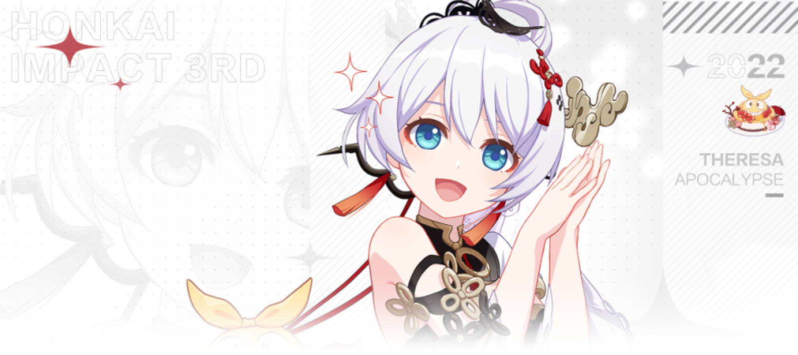
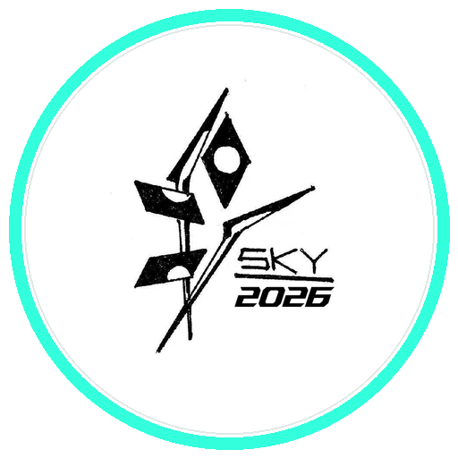
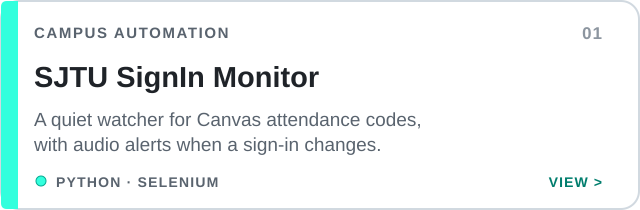
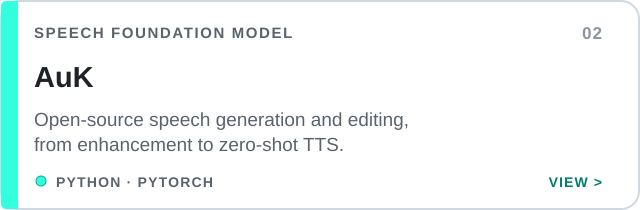
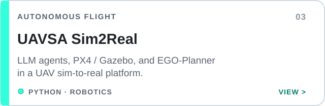
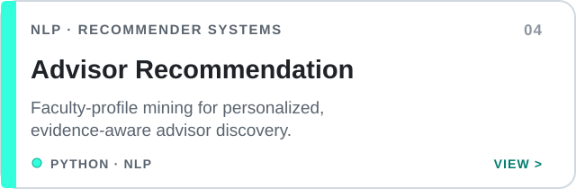
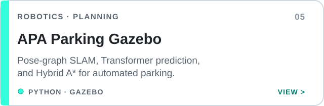
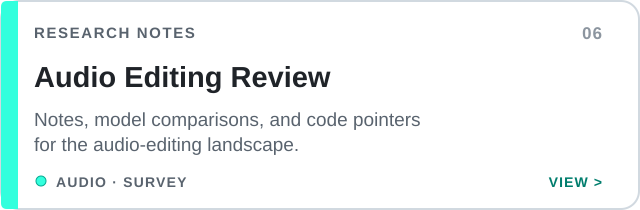
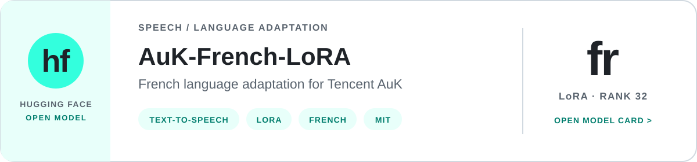
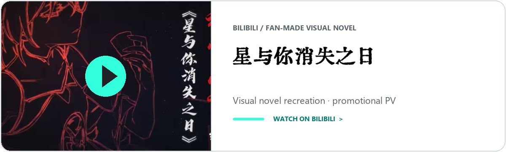

  

  

<h1 align="center">Iceky Prime</h1>

  <strong>AI · SPEECH INTELLIGENCE · AUTONOMOUS FLIGHT</strong> 
  Student at Shanghai Jiao Tong University

  Building systems that listen, speak, and find their way through the world.

  
  &nbsp;
  

---

## About

I'm an SJTU student exploring AI through speech technology and UAV systems. My current work spans speech generation and editing, language adaptation, LLM agents, and sim-to-real autonomy.

I enjoy turning research ideas into working prototypes, then testing where they break. Away from code, I create fan works centered on a fixed cast of favorite anime characters. I'm still learning, and constructive feedback is always welcome.

## Featured Work

  
  

  
  

  
  

## Open Model

## Creative Work

## Toolbox

  
  
  
  
  
    
  
  
  
  
  

---

  <strong>Learning in public. Building with curiosity.</strong> 
  Thoughtful feedback, research discussions, and creative collaborations are always welcome.

